# Running and using DMS on localhost

This guide shows how to run DMS on your own computer at **http://localhost:5173** and walks through using it.

When you run DMS locally you don't need a Firebase project or internet hosting. `npm run local` starts a **local copy of Firebase** (the Firebase emulators) with the same security rules as the live app, and loads demo accounts and the starter formats.

---

## 1. Install the tools (one time)

| Tool | Why | Get it |
|---|---|---|
| **Node.js 20 or newer** (LTS) | Runs the app | <https://nodejs.org> → download the **LTS** installer |
| **Java 21 or newer** | Runs the local Firebase emulators | <https://adoptium.net> → **Temurin 21 (LTS)** installer |
| **Git** | Downloads the code | <https://git-scm.com/downloads> |

To check, open **Command Prompt** (Windows) or **Terminal** (Mac) and run:

```bash
node -v      # v20.x or higher
java -version   # "21" or higher
git --version
```

On Windows, close and reopen Command Prompt after installing so it picks up the new tools.

## 2. Download the code (one time)

```bash
git clone https://github.com/npp-prog/fts.git
cd fts
git checkout ccr-fac8062d-2kj3lp     # the branch with the app (until it is merged)
npm install
```

## 3. Start DMS

```bash
npm run local
```

On the **first run** this:

1. downloads the Firebase emulators, which takes about a minute;
2. starts a local login service and a local database;
3. loads the demo data;
4. opens **http://localhost:5173** in your browser.

If your browser doesn't open by itself, open that address yourself.

You should see this in the terminal:

```
[DMS] Demo data loaded:
      Superadmin  npp@mgocandoniaccounting.org / admin123
      End user    user@fts.local / user123
      Offices     acctg@, budget@, treasury@, mayor@fts.local / user123
      Formats     DV, OBR, FURS, PAYROLL, PCV, LR, IT, PR, PO, JO
      Checklists  210 (disbursement and liquidation)
[DMS] Starting the app at http://localhost:5173 …
```

**To stop:** press **Ctrl + C** in the terminal, once. DMS saves your local data to the `.emulator-data` folder and loads it again the next time you run `npm run local`.

**To start over with fresh demo data:** stop DMS, run `npm run local:reset`, then run `npm run local` again. Do this once after updating DMS, so the demo data includes the latest formats and checklists.

> Everything here stays on your computer. Accounts and documents you create locally are not on the live site, and live data is not here.

---

## 4. Using DMS as an end user

Sign in as **user@fts.local** / **user123**.

### Sign in

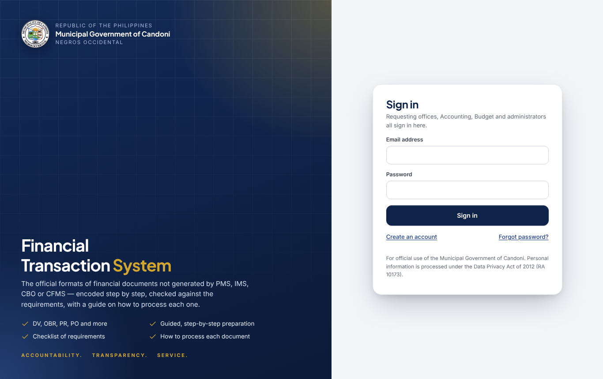

A new person can click **Create an account**. An administrator then approves the account under **Users**.

### Dashboard

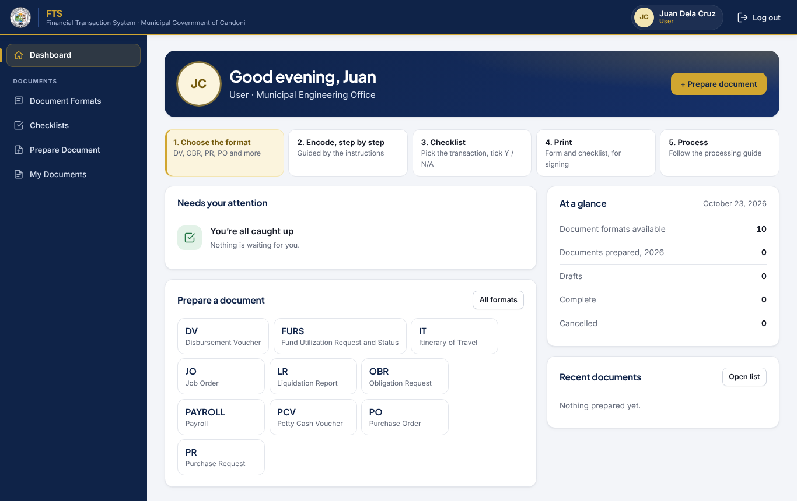

The dashboard shows:

- the five-step flow: choose the format → encode → checklist → print → process;
- **Needs your attention**: your drafts to finish and your completed documents to print;
- shortcuts to each document format;
- **At a glance**: your document counts.

### Document formats

**Document Formats** lists every form: DV, OBR, FURS, Payroll, PCV, LR, Itinerary of Travel, PR, PO and JO.

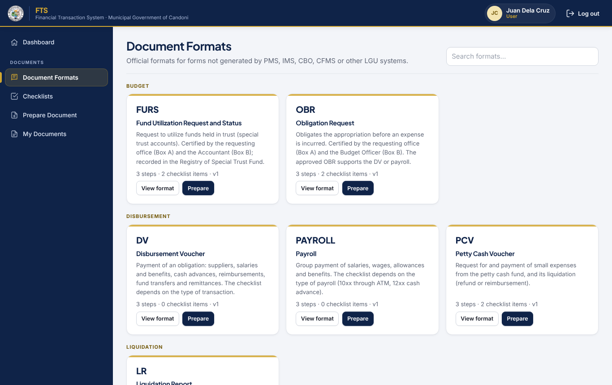

**View format** shows three things:

- the guided encoding steps;
- **How to process this document**: which office receives the document, in what order, and what each does;
- the blank printable form.

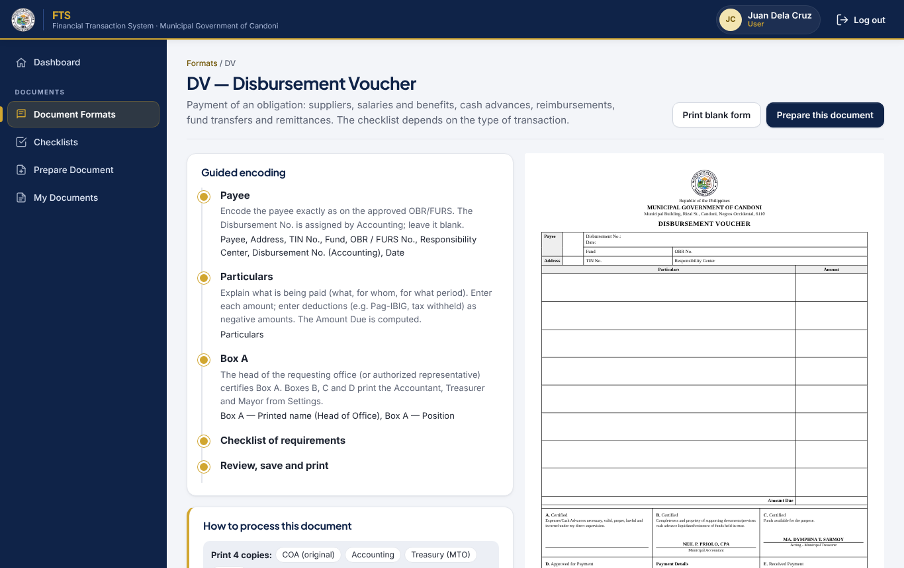

### Checklists

**Checklists** has all 210 checklists of the Municipal Accounting Office: 201 for disbursements and 9 for liquidations, grouped by category. Search by number or by words.

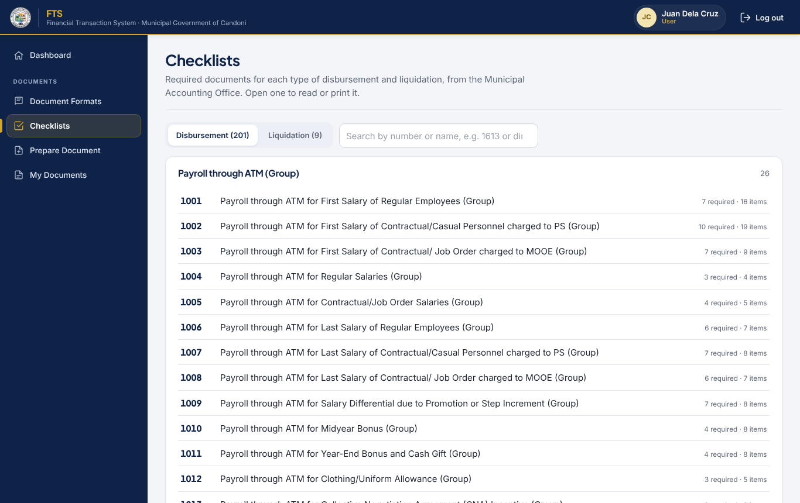

Open a checklist to read it or print a blank copy:

- an item with only a **Y** box (N/A shaded) is always required;
- an item with **Y** and **N/A** boxes is required only if it applies.

The printout follows the Accounting Office's Word checklist: A4, Times New Roman, numbered items. Every requirement has a **Document Type** (the generic name of the document, e.g. *BAC Resolution*) and **Document Details** (the instruction that specifies it).

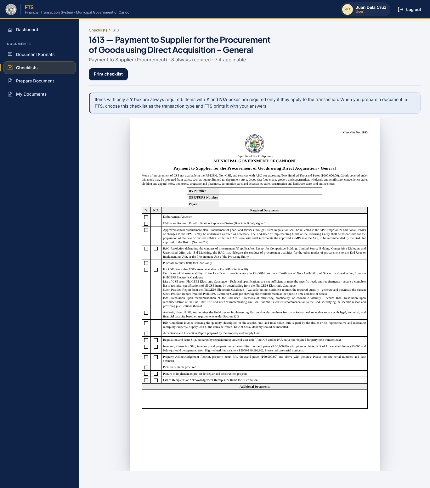

### Encode the details

Click **Prepare this document**, or go to **Prepare Document** and pick a format. Fill in each step. Everything you type is in capital letters, as on the official forms, and prints that way. The instructions for the step are shown in the blue box, and the preview on the right updates as you type. You can't go to the next step until the required fields (marked \*) are filled in.

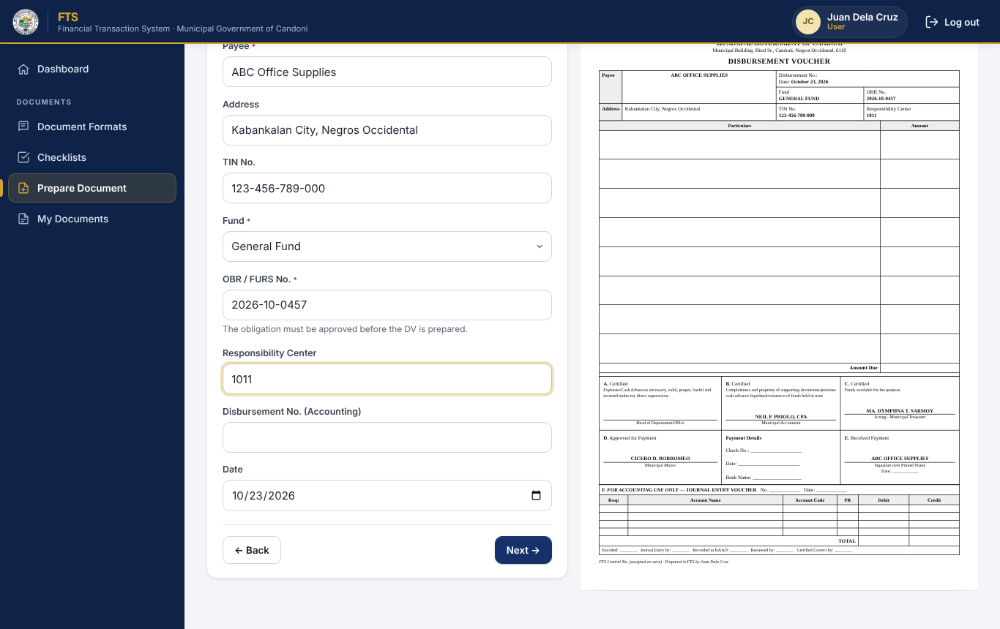

For line items, click **+ Add row**. On the DV, the **Explanation** is a paragraph box: write the particulars in full and press Enter for a new line; it prints the same way. Enter deductions as negative amounts: they print in parentheses, like `(164.73)`. The Amount Due fills in automatically. The printed names in boxes B, C and D come from Settings.

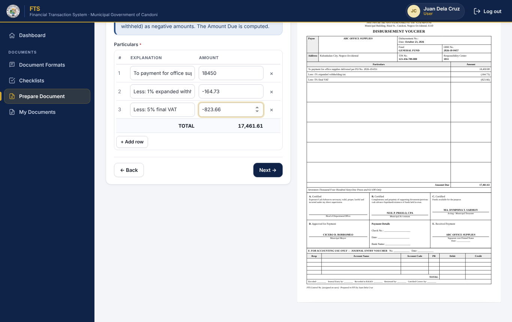

### Checklist step: choose the transaction, tick what you attached

Only the **DV** and the **Liquidation Report** have a checklist (the other forms go straight to Review & Save). Their Checklist step asks for the **type of transaction**. Type a checklist number or some words (e.g. `1613` or `direct acquisition`, or `2002` for a liquidation of local travel) and pick one. Its checklist from the Municipal Accounting Office loads, and the preview on the right shows it as it will print. To pick another, click **Change**; the answers you already gave are cleared.

- tick **Y** for each document you attached;
- tick **N/A** for items that don't apply (always-required items have no N/A);
- the preview on the right shows the checklist as it will print, with your answers.

**Upload supporting documents.** On the document page, each checklist item also has **+ Upload file**: attach a scanned PDF or a photo (JPG or PNG, up to 20 MB) from your computer, tablet or phone camera. The item is ticked **Y**, the file is listed under it (and on the printed checklist as *Linked: File: …*), and clicking its name shows it in the document page's viewing area, with **Download**. Uploaded files are included in **Download all (ZIP)**, named like the rest, e.g. `GF_NEIL PRIOLO_03_TO_DMS2026000001.pdf`. The offices the document is routed to can open them too.

**Link the supporting documents.** Under each item, **+ Link document** lets you pick a document already in DMS, of the kind the item asks for (under *Obligation Request* only OBRs, and FURS since the item accepts one; under *Purchase Request* only PRs) or enter a link to another system (PIM, CBO, CFMS, DMS) with its reference number. Property and supply documents generated by **PIM** (PMS-IMS): AIR, PAR, ICS, RIS, PTR, ITR, WMR, Pre/Post Inspection Report, History of Repair and RSMI open straight on the other-system tab with PIM chosen. A linked item is ticked **Y**. You can also add or remove links later on the document page, even after the document is complete (the preparer and administrators; each change is recorded in History). Links open from the document page, and the printed checklist shows them, e.g. *Linked: DMS-2026-000003 (OBR)* or *Linked: CBO: PR-2026-10-0031*.

Attaching something that is not on the checklist? Under **Additional documents**, click **+ Add document** and type it. They are numbered after the checklist's last item (after a 15-item checklist: 16, 17, …) and listed in the **Additional Documents** box of the printed checklist.

**Picked the wrong checklist, or the requirements changed?** On the document page, **Change checklist** (next to the checklist) opens the Checklist step to choose another type of transaction. Answers and links of requirements that are on both checklists (e.g. the DV and OBR) are kept; the others are cleared. Save again afterwards.

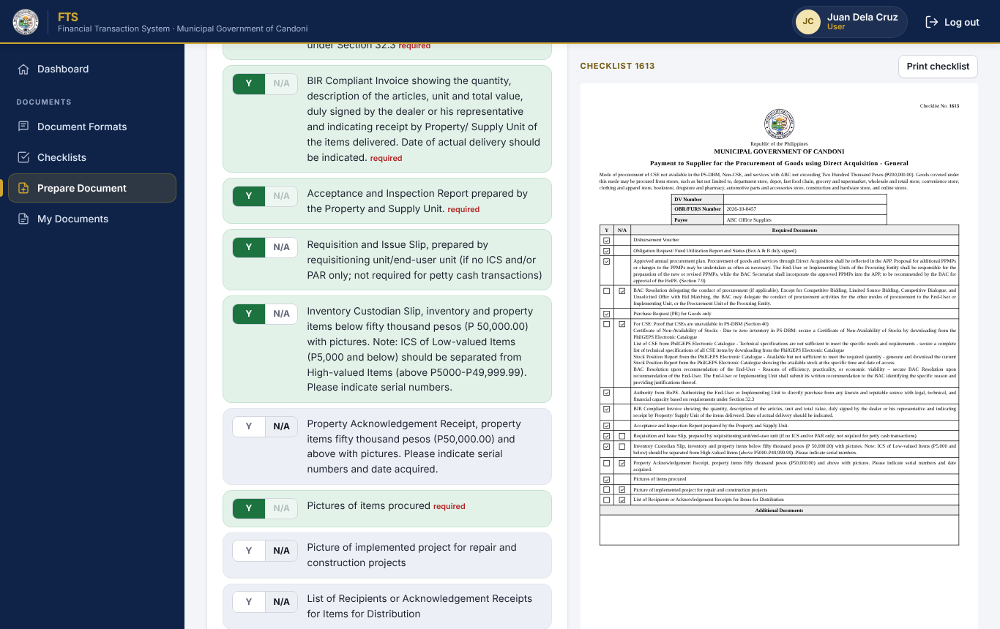

**Review & Save** tells you what is still missing. **Mark complete** stays disabled until every required field and every always-required checklist item is done.

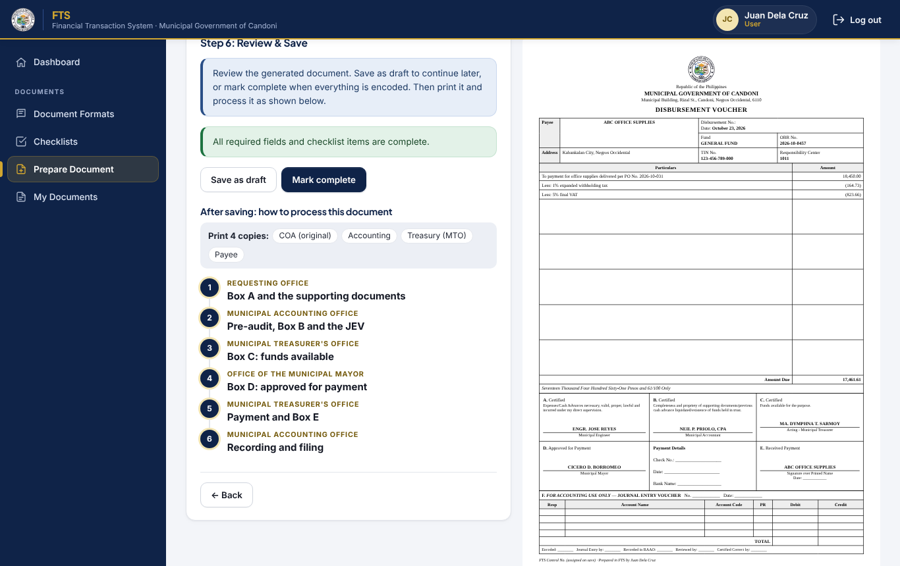

### Print and process

The completed document gets a control number, e.g. `DMS-2026-000001`. Above the preview are two tabs: **DV** and **Checklist 1613**. **Print** prints whichever tab you are on, so print both and put the checklist on top of the attachments. Printing is automatic:

- **Portrait, one page.** Every form prints portrait on one page: the DV on Folio (8.5 × 13 in), everything else on A4. Forms that are too tall (many lines) or too wide (many columns) are scaled down to fit.
- **Fills the page.** When there is room left, the main table (particulars, items, employees) stretches to the bottom of the page, like a pre-printed form.
- **What you see is what prints.** The preview is the printed page, scaled to fit your screen. A very long checklist, such as competitive bidding, stays readable and continues on a second page. In the browser's print dialog, leave the scale at **Default** and the paper size as set. Then send the paper along its route (next section).

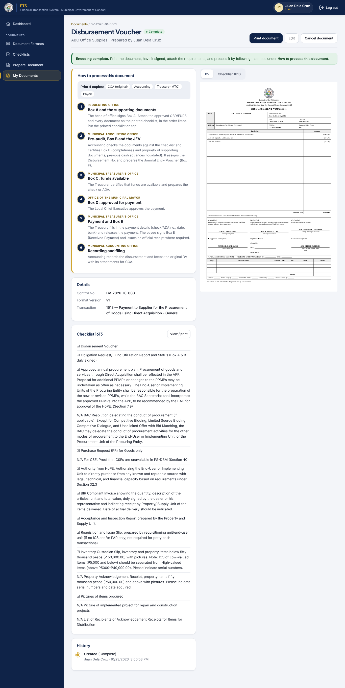

| The DV (Folio, 8.5 × 13 in) | The checklist cover sheet, filled in (A4) |
|---|---|
| 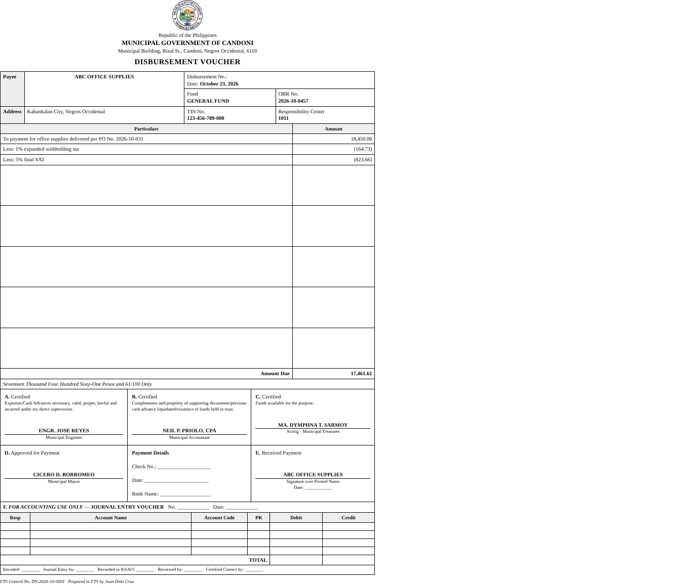 | 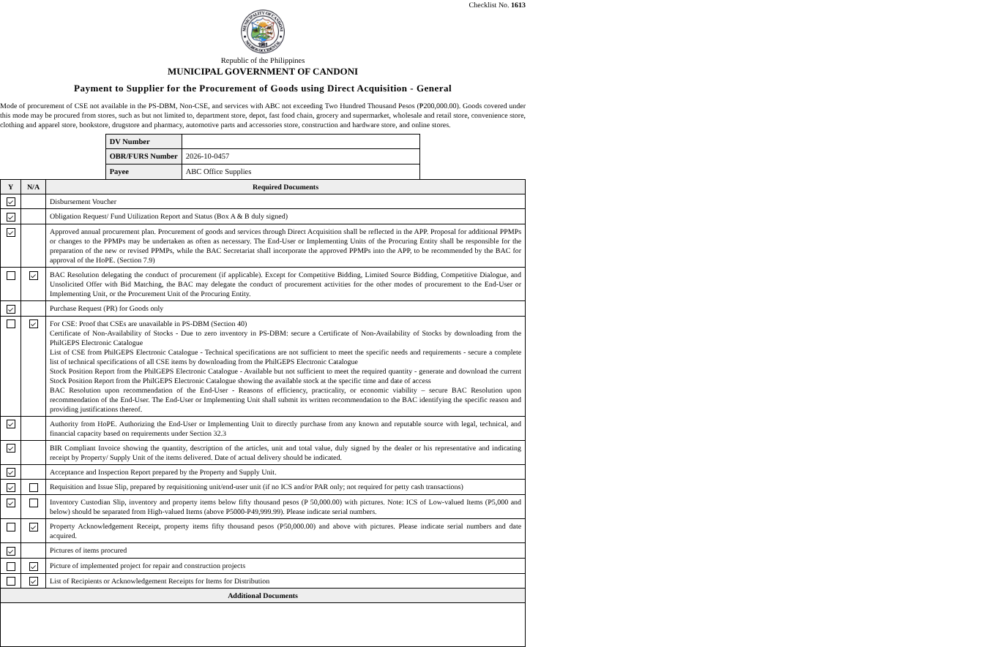 |

The checklist's header boxes (DV Number, OBR/FURS Number, Payee) fill in from the document.

### Workflow: where is the document?

When you **convert a document to PDF**, DMS starts its **workflow**: from then on the PDF goes from office to office along the route set under Administration → Workflow (or, if none is set, the steps of **How to process this document**). Marking it complete is not enough: the document leaves your office only as a PDF. For a DV: your office → Municipal Accounting Office → Municipal Treasurer's Office → Office of the Municipal Mayor → Treasurer's Office → Accounting. The **Workflow** card on the document shows each office, where the document is now, and who received or released it and when.

- **Release.** When the paper leaves your office, click **Release to Municipal Accounting Office**. From then on you can't edit the document.
- **Receive.** The next office finds it in its **Inbox** (left menu, with the number waiting) and clicks **Receive** when the paper arrives.
- **Release or return.** After acting on it, the office releases it to the next office, or clicks **Return to …** and says why (e.g. *OBR not signed*). The document goes back one office.
- **Mark processed.** The last office closes the route.

**Documents** shows a **Where** column for every document. An office sees the documents routed through it. A document completed before this feature has a **Start workflow** button.

To try it locally, sign in one after the other (password `user123`) as `user@fts.local` (Engineering), `acctg@fts.local`, `treasury@fts.local` and `mayor@fts.local`. `budget@fts.local` is the Municipal Budget Office, on the OBR route.

### Convert to PDF and sign with your PNPKI digital signature

When the document is final, click **Convert to PDF** under **PDF and digital signatures**. DMS makes one PDF: the document, then its checklist (DV and LR). Then each signatory signs it while the document is in their office (after receiving it):

- **Register your digital signature once, in My Profile** (left menu, or click your name at the top). Upload your DICT certificate file (`.p12` or `.pfx`) and type its password to check it's yours; the password is not stored. Upload a picture of your handwritten signature as your **signature mark** (dark ink on white paper, or a PNG with a transparent background); DMS makes the paper see-through and crops it. Only you can use them, not even an administrator; change or remove them there any time, e.g. when DICT renews your certificate.
- **Password every time, or remembered on this device.** Under **When I sign** in My Profile, keep **Ask for my password every time** (recommended), or choose **Remember my password on this device** for 8 hours, 7 days or 30 days and type it once. It is kept only in that browser, encrypted with a key the browser cannot export, and never sent to DMS; it is forgotten when the time is up, when you change your certificate, or when you click **Forget it now**. While it is remembered, anyone using your DMS account on that device can sign as you, so use it only on your own device.
- **Sign in DMS.** Click **Sign with PNPKI**. Choose a size for your mark (Small fits a DV signature line), **tap the PDF where it goes** (e.g. the Signature line of your box; tap again to move it), type your certificate password and click **Sign PDF**. The mark is drawn there with *Digitally signed by NAME* and the date and time, and your digital signature covers it. Untick **Place my signature mark** to sign without it.
- **Or sign in Adobe Acrobat.** Click **Upload signed PDF**, download the current PDF, sign it in Acrobat (or Foxit) with your PNPKI certificate, change nothing else, and upload it. DMS checks that it is the same PDF with your signature added.

Each signature is added after the ones already there, so they all stay valid, as when several people sign in Acrobat. The card lists every signature with ✓ (intact and matching the certificate) or ✗, and a **DICT PNPKI** badge when the certificate was issued by the PNPKI. **Versions** keeps every version (converted, then each signature). Once the PDF is signed the document can't be edited; if it was changed after converting and before anyone signed, **Convert again**. The document page shows the document in the centre and its cards (Workflow, PDF and digital signatures, Details, Checklist, History) on the right. Once converted, the **PDF** tab (**Signed PDF** once signed) shows the PDF itself inside the page, page by page, with its signatures on top; **View PDF** opens it. **Download PDF** gives you the current (signed) PDF, named like the bulk download, e.g. `GF_NEIL P. PRIOLO_01_DV_DMS2026000001.pdf`.

To try it locally you need a certificate file. Real PNPKI certificates come from DICT; for testing, any `.p12` works (DMS shows *Not PNPKI* for certificates from other issuers and asks before signing).

### See a signature and its certificate

Each signature with a mark is the signature itself, on the face of the PDF. **Click it** (in the PDF tab of the document page) to see its details: whether it is valid (the document has not changed since it was signed), when it was signed, the reason and location, and the certificate: who it was issued to, the issuer with a **DICT PNPKI** badge, its validity, serial number and certificate chain. The names at the top of the PDF open the same details, also for signatures without a mark. In a downloaded copy, click the signature in Adobe Acrobat or Foxit to see the same, with the trust of the DICT PNPKI root checked by the reader.

**Download all (ZIP).** On a DV, **Download all (ZIP)** puts the DV (its signed PDF, once converted), its checklist and every document linked to the checklist into one ZIP, each as a PDF named **Fund_Payee_Checklist No._Document Type_FTS No.**, for example:

```
GF_NEIL PRIOLO_01_DV_DMS2026000004.pdf
GF_NEIL PRIOLO_00_CHECKLIST 1613_DMS2026000004.pdf
GF_NEIL PRIOLO_02_OBR_DMS2026000003.pdf
GF_NEIL PRIOLO_05_PR_CBO PR-2026-10-0031.url
00_INDEX.txt
```

The checklist number is the item's number on the checklist (00 for the checklist itself). Documents linked from other systems (PIM, CBO, …) cannot be downloaded by DMS; they are included as shortcuts (`.url`) that open the link. `00_INDEX.txt` lists everything, including linked documents you have no access to. Admins can turn **Bulk download** on for other document types (Document Types → General). The DV Number box stays blank until Accounting assigns the number.

### Computed amounts (example: Liquidation Report)

Totals are computed as you type. On the Liquidation Report, for example, DMS computes the total amount spent and the amount to be reimbursed (total spent − cash advance + refund). (The liquidation type, e.g. **2002 – Local Travel**, was chosen in step 1.)

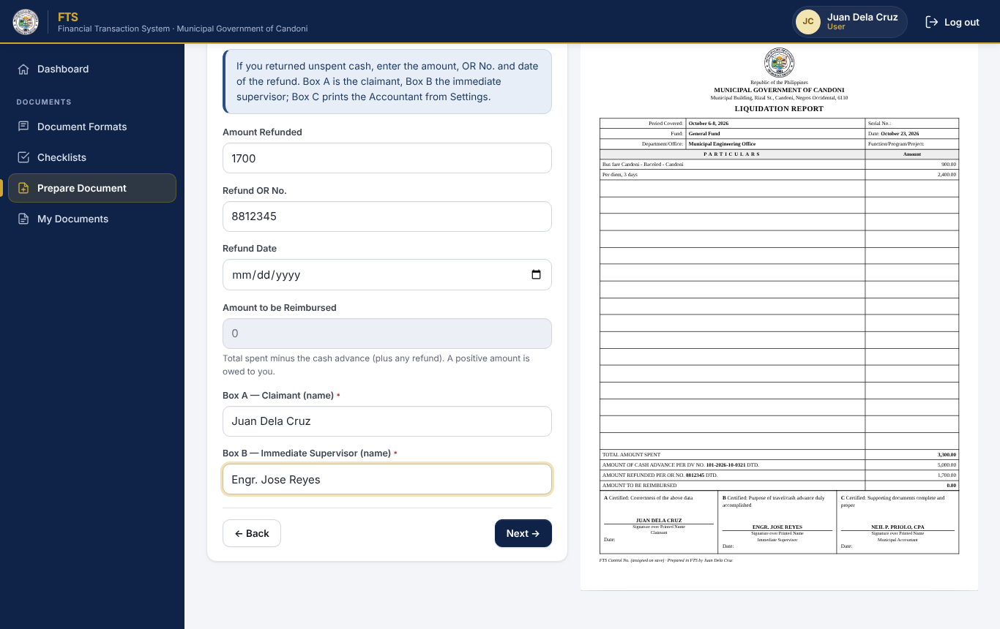

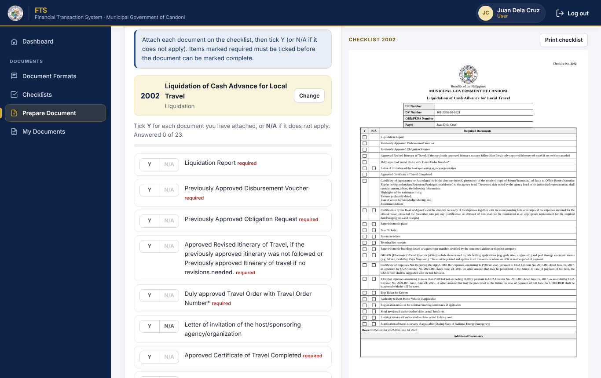

---

## 5. Using DMS as an administrator

Sign out (top right), then sign in as **npp@mgocandoniaccounting.org** / **admin123** (local demo password). On the live site, `npp@mgocandoniaccounting.org` is the superadmin: sign in with **Continue with Google**, or register with email and password and open the verification link.

### Checklists

On **Checklists**, an administrator can:

- **load the checklist library**: on the live site, click this once;
- **reload the original library**, which overwrites your edits;
- create a new checklist;
- edit or delete any checklist.

The editor shows the printed checklist as you edit. Each item has a **document type** and optional **document details**, is either **Always required (Y)** or **If applicable (Y / N/A)**, and can have a group heading (e.g. *Progress Payment*, *Final Payment*). In notes, put `**double asterisks**` around words to print them in bold.

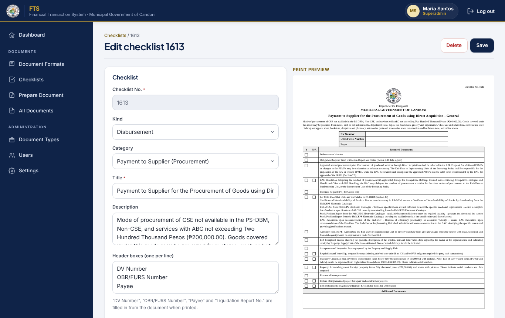

### Document types

Each document type has six tabs: **General** (code, name, paper size: **A4**, **Folio (8.5 × 13 in)**, Letter or Legal), **Guided Steps**, **Fields**, **Checklist**, **Processing Guide** and **Format / Template**.

In the **Checklist** tab, **Checklist source** decides where the checklist comes from:

- **Own checklist**: a fixed list you write here;
- **Disbursement library** or **Liquidation library**: the wizard starts with *Type of Transaction*, as shown above.

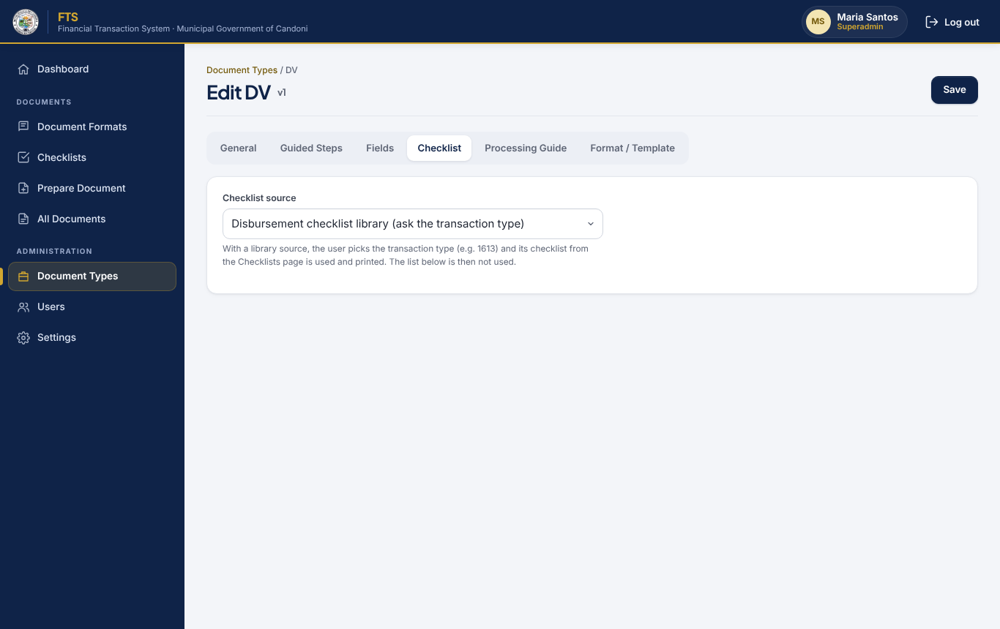

The **Processing Guide** tab has the routing steps: which office receives the document, in what order, and what each does.

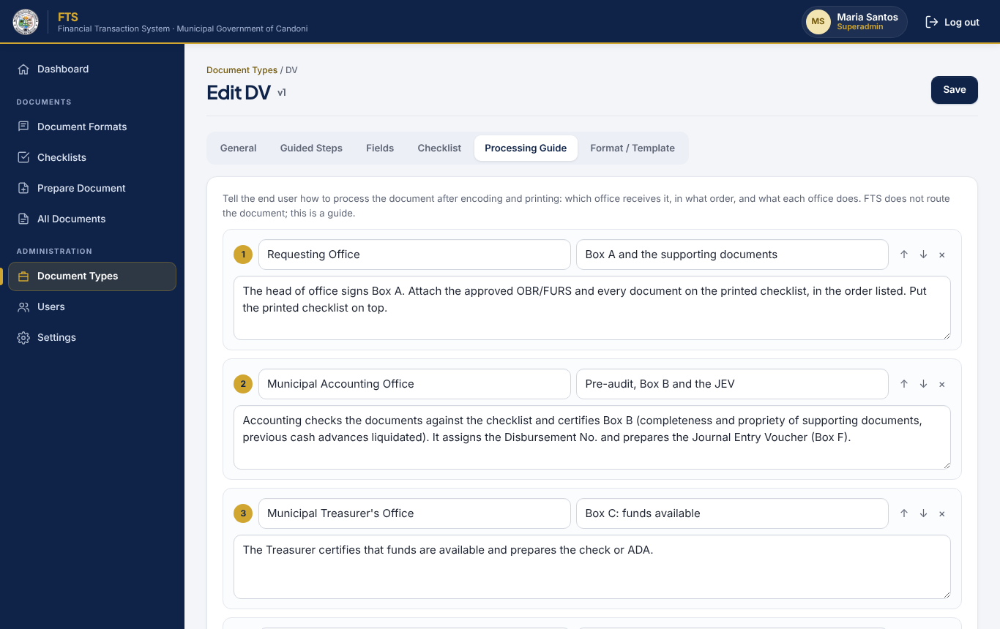

Fields can be **computed**: in a table column or a field, the formula combines other keys with `+`, `-` and `*`, and `sum:table.column` adds up a table column. For example, `qty*unitCost`, `gross-deductions` or `sum:items.amount-cashAdvance`.

### Settings and users

**Settings** (superadmin only) holds:

- the LGU name, address and seal;
- the **signatories**: Mayor, Accountant, Budget Officer, Treasurer and Secretary to the Sanggunian. These are printed where the official forms pre-print a name. Each document keeps the signatories that were set when it was prepared.

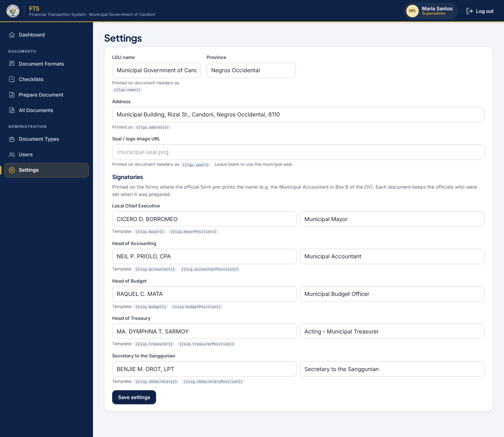

### Workflow: set the flow of every document

**Administration → Workflow → Routes** sets the route of each document type. Pick a type on the left; the right side lists its steps in order. For each step choose the **office** (or *Preparer's office*, whichever office prepared the document), type the **action** (what that office does, e.g. *Pre-audit, Box B and the JEV*), and tick **Must sign the PDF before releasing** where that office signs with its PNPKI digital signature. The office can't release the document until it has signed. Add, remove and reorder steps with **+ Add step**, ×, ↑ and ↓. The preview at the top shows the route. Click **Save route**.

A type with no route yet follows its processing guide; the editor starts from it. New documents follow the saved route; documents already on their way keep the route they started with. Saving a route doesn't change the document format or its version.

**Workflow → Tracking** shows every routed document: where it is now, its progress along the route, and the last action with any remarks. The tiles filter it (*On the move*, *In your office*, *Returned*, *Processed*, *All routed*), and **Now at** filters by office.

**Users** is where you approve new accounts and **assign each person to an office**. Users see only the documents of their own office (and their own); administrators see all documents and can filter by office. The office someone types when registering is only a request, shown as *Asked for*. The list of offices is in **Settings**. Only the superadmin can make someone an administrator.

**Who sees what.** A user sees the documents they prepared and the documents waiting in their office to be received, signed and released, so a signatory sees what they sign. They don't see a colleague's documents. Tick **Office head** next to a user's office to let them see every document of the office and every document routed through it. Administrators see all documents.

To try it locally: `user@fts.local` (Juan) and `ana@fts.local` (Ana, the office head) are in the Municipal Engineering Office: Ana sees Juan's documents, Juan doesn't see Ana's. `acctg@fts.local` sees a DV only while it waits in the Accounting Office; `leo@fts.local` (Health) sees none of them.

---

## Troubleshooting

| Problem | Fix |
|---|---|
| `java` is not recognized / "Java 21 or newer" | Install Temurin 21 from <https://adoptium.net>, then reopen the terminal |
| `Port 8080 is not open` or `port taken` | Another program is using that port. Close it, or change the ports in `firebase.json` (`emulators.firestore.port` / `emulators.auth.port`), `src/firebase.js` and `scripts/seed-local.mjs` |
| The page says "Firebase is not connected yet" | You ran `npm run dev` instead of `npm run local`. Use `npm run local` for the local copy |
| Want to use your real Firebase project locally | Paste your project's config into `src/firebase-config.js` and run `npm run dev` |
| Want fresh demo data | `npm run local:reset`, then `npm run local` |
| Local data isn't kept between runs ("Automatic export failed") | Stop with a single Ctrl + C and wait for "Export complete". On a network that forces a proxy (`HTTPS_PROXY` set), the save can fail. Clear that variable in the terminal before running `npm run local` |
