# Running and using FTS on localhost

This guide shows how to run FTS on your own computer at **http://localhost:5173** and walks through using it.

When you run FTS locally you don't need a Firebase project or internet hosting. `npm run local` starts a **local copy of Firebase** (the Firebase emulators) with the same security rules as the live app, and loads demo accounts and the starter formats.

---

## 1. Install the tools (one time)

| Tool | Why | Get it |
|---|---|---|
| **Node.js 20 or newer** (LTS) | Runs the app | <https://nodejs.org> → download the **LTS** installer |
| **Java 21 or newer** | Runs the local Firebase emulators | <https://adoptium.net> → **Temurin 21 (LTS)** installer |
| **Git** | Downloads the code | <https://git-scm.com/downloads> |

To check, open **Command Prompt** (Windows) or **Terminal** (Mac) and run:

```bash
node -v      # v20.x or higher
java -version   # "21" or higher
git --version
```

On Windows, close and reopen Command Prompt after installing so it picks up the new tools.

## 2. Download the code (one time)

```bash
git clone https://github.com/npp-prog/fts.git
cd fts
git checkout ccr-fac8062d-2kj3lp     # the branch with the app (until it is merged)
npm install
```

## 3. Start FTS

```bash
npm run local
```

On the **first run** this:

1. downloads the Firebase emulators, which takes about a minute;
2. starts a local login service and a local database;
3. loads the demo data;
4. opens **http://localhost:5173** in your browser.

If your browser doesn't open by itself, open that address yourself.

You should see this in the terminal:

```
[FTS] Demo data loaded:
      Superadmin  admin@fts.local / admin123
      End user    user@fts.local / user123
      Formats     DV, OBR, PR, PO
[FTS] Starting the app at http://localhost:5173 …
```

**To stop:** press **Ctrl + C** in the terminal, once. FTS saves your local data to the `.emulator-data` folder and loads it again the next time you run `npm run local`.

**To start over with fresh demo data:** stop FTS, run `npm run local:reset`, then run `npm run local` again.

> Everything here stays on your computer. Accounts and documents you create locally are not on the live site, and live data is not here.

---

## 4. Using FTS as an end user

Sign in as **user@fts.local** / **user123**.

### Sign in


A new person can click **Create an account**. An administrator then approves the account under **Users**.

### Dashboard


The dashboard shows:

- the five-step flow: choose the format → encode → checklist → print → process;
- **Needs your attention**: your drafts to finish and your completed documents to print;
- shortcuts to each document format;
- **At a glance**: your document counts.

### Look up a format and how to process it

Open **Document Formats** to see every format, grouped by category.


**View format** shows three things:

- the guided encoding steps;
- **How to process this document**: which office receives it, in what order, and what each one does;
- the checklist of requirements and a blank printable form.

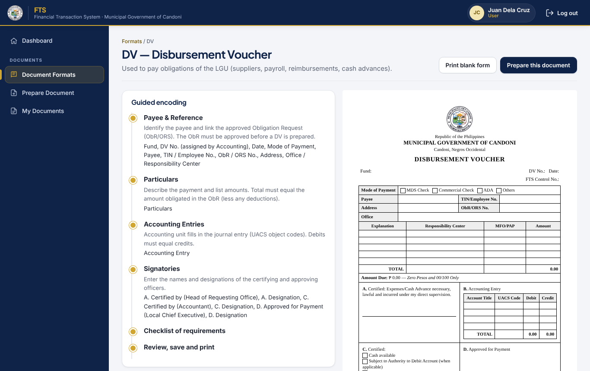

### Encode a document

Click **Prepare this document**, or go to **Prepare Document** and pick a format. Fill in each step. The instructions for the step are shown in the blue box. You can't go to the next step until the required fields (marked \*) are filled in. The preview on the right updates as you type.

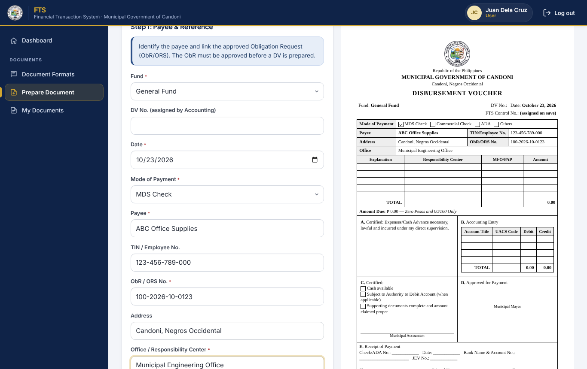

For line items, click **+ Add row**. Totals, computed amounts and the amount in words fill in automatically.

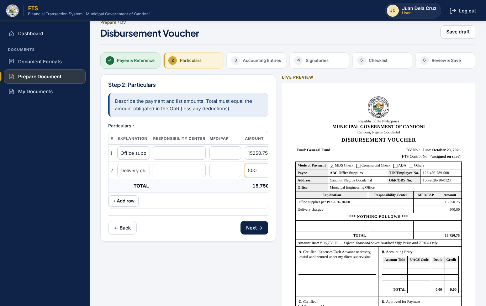

In the **Checklist** step, tick each requirement you have attached. Required items must be ticked before the document can be marked complete.

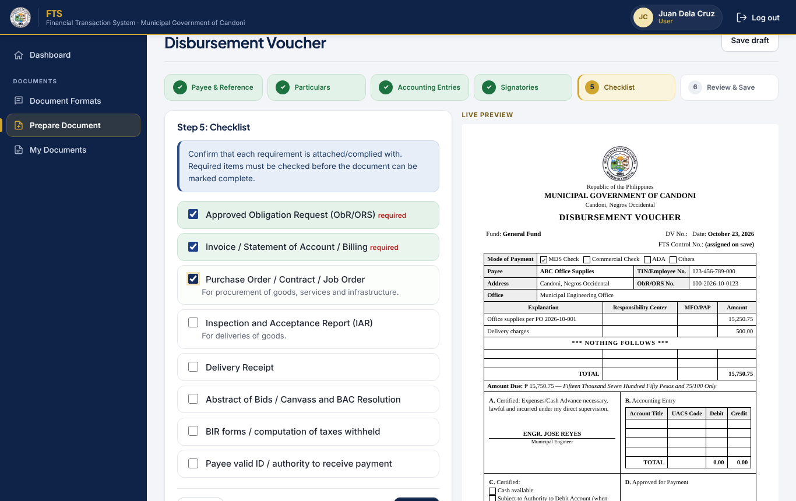

In **Review & Save** you can:

- choose **Save as draft** to continue later, or **Mark complete** when everything is encoded;
- see the processing guide again, so you know what to do next.

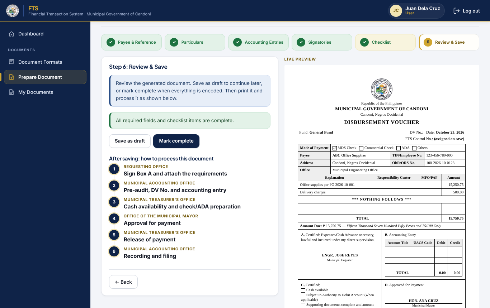

### Print and process

The completed document gets a control number, e.g. `DV-2026-10-0001`. Click **Print**: only the form prints, on the paper size set for that format. Then follow **How to process this document**, office by office. FTS doesn't route the document; the guide tells you where it goes next.

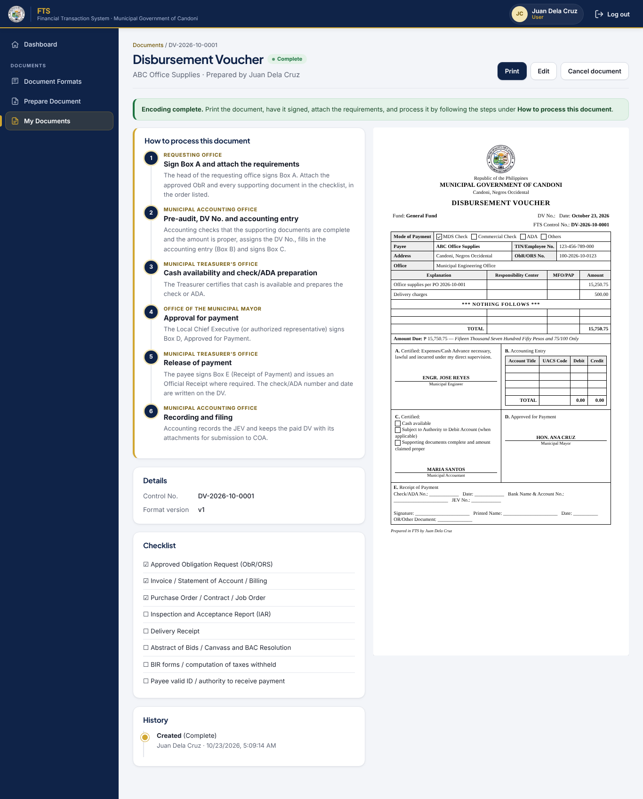

What the printout looks like:

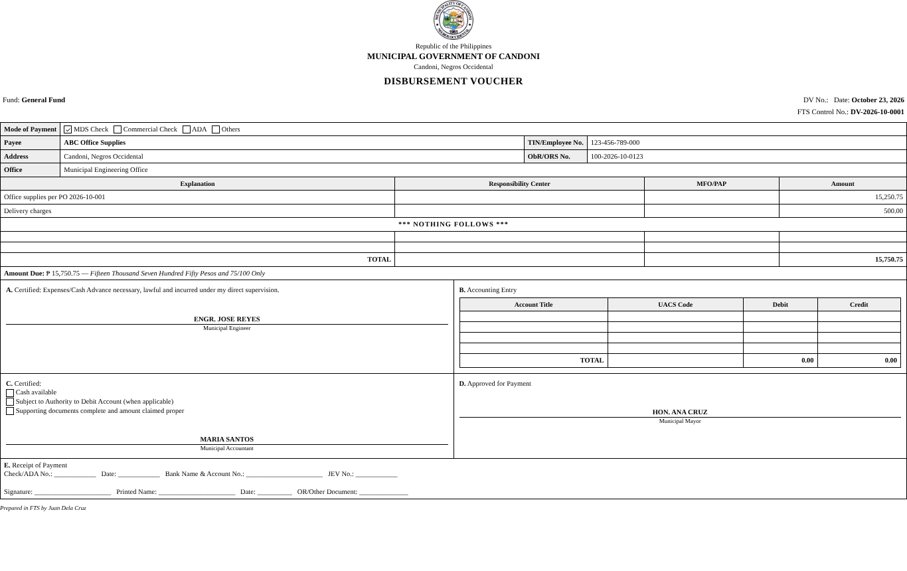

**My Documents** lists everything you have encoded. You can search and filter it, and open any document to print it again or edit it. A document you cancel can no longer be edited.

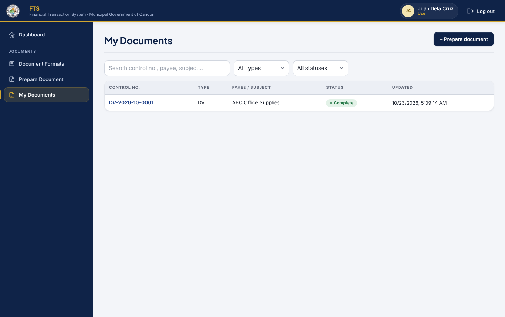

---

## 5. Using FTS as an administrator

Sign out (top right), then sign in as **admin@fts.local** / **admin123**. On the live site, the first account ever registered becomes the superadmin.

### Document types

**Document Types** lists every format. Here you can:

- add a new document type;
- edit, preview, deactivate or delete a type;
- import or export types as JSON;
- load the starter formats (DV, OBR, PR, PO).

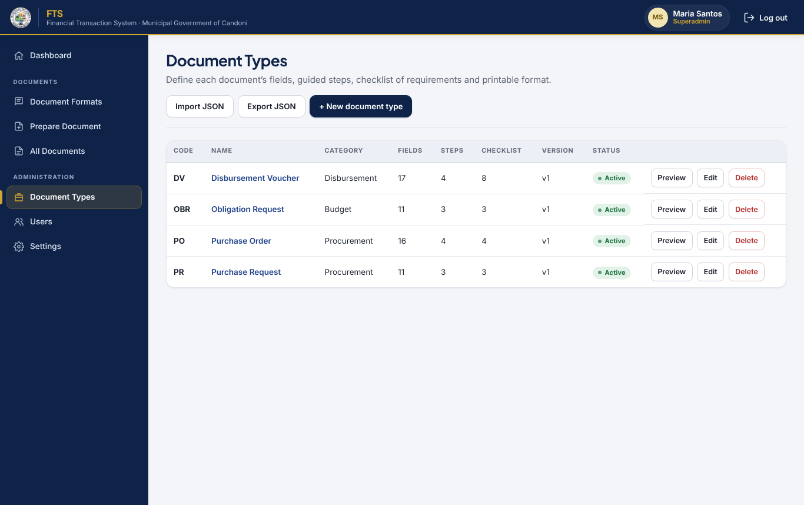

Each document type has six tabs:

| Tab | What you set |
|---|---|
| **General** | Code (e.g. `DV`), name, category, paper size and orientation, and whether it is active |
| **Guided Steps** | The steps users go through, with instructions for each |
| **Fields** | What users encode: text, amount, date, dropdown, or a table of line items with computed columns and totals. Assign each field to a step |
| **Checklist** | The requirements to attach, each marked required or optional |
| **Processing Guide** | How to process the document after encoding: the office, the action, and details for each step |
| **Format / Template** | The printed layout, with a live preview. **Generate from fields** gives you a starting layout |

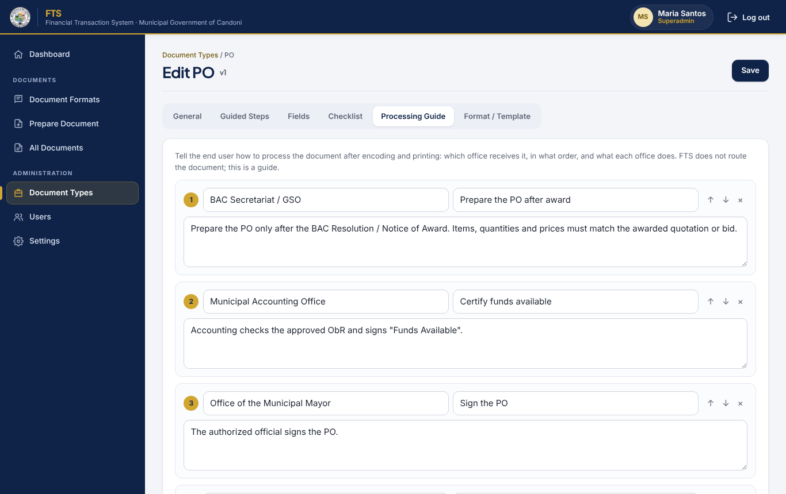

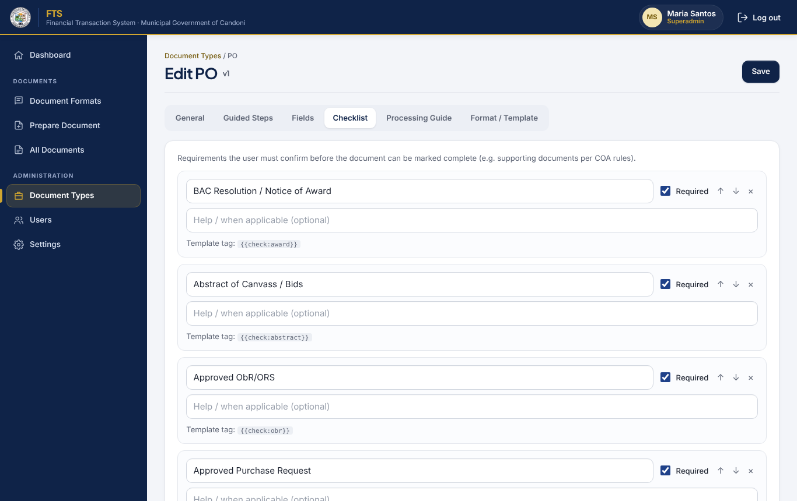

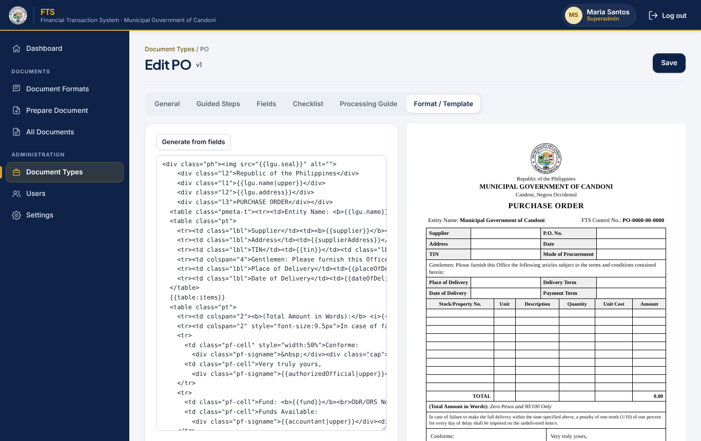

Click **Save** when done. Documents encoded earlier keep the version of the format they were made with.

### Users and settings

**Users** is where you approve new accounts and deactivate old ones. Only the superadmin can make someone an administrator.

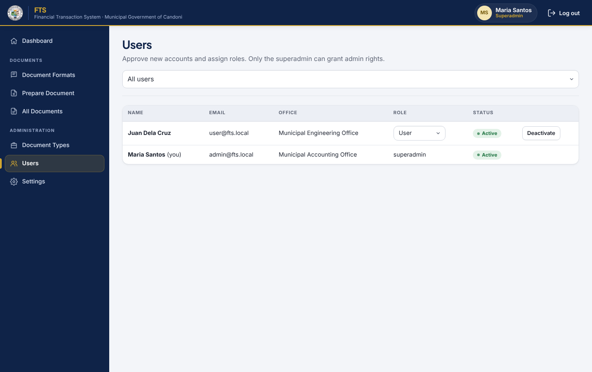

**Settings** (superadmin only) holds the LGU name, address and seal printed on every form.

---

## Troubleshooting

| Problem | Fix |
|---|---|
| `java` is not recognized / "Java 21 or newer" | Install Temurin 21 from <https://adoptium.net>, then reopen the terminal |
| `Port 8080 is not open` or `port taken` | Another program is using that port. Close it, or change the ports in `firebase.json` (`emulators.firestore.port` / `emulators.auth.port`), `src/firebase.js` and `scripts/seed-local.mjs` |
| The page says "Firebase is not connected yet" | You ran `npm run dev` instead of `npm run local`. Use `npm run local` for the local copy |
| Want to use your real Firebase project locally | Copy `.env.example` to `.env.local`, fill in your project's values, and run `npm run dev` |
| Want fresh demo data | `npm run local:reset`, then `npm run local` |
| Local data isn't kept between runs ("Automatic export failed") | Stop with a single Ctrl + C and wait for "Export complete". On a network that forces a proxy (`HTTPS_PROXY` set), the save can fail. Clear that variable in the terminal before running `npm run local` |
